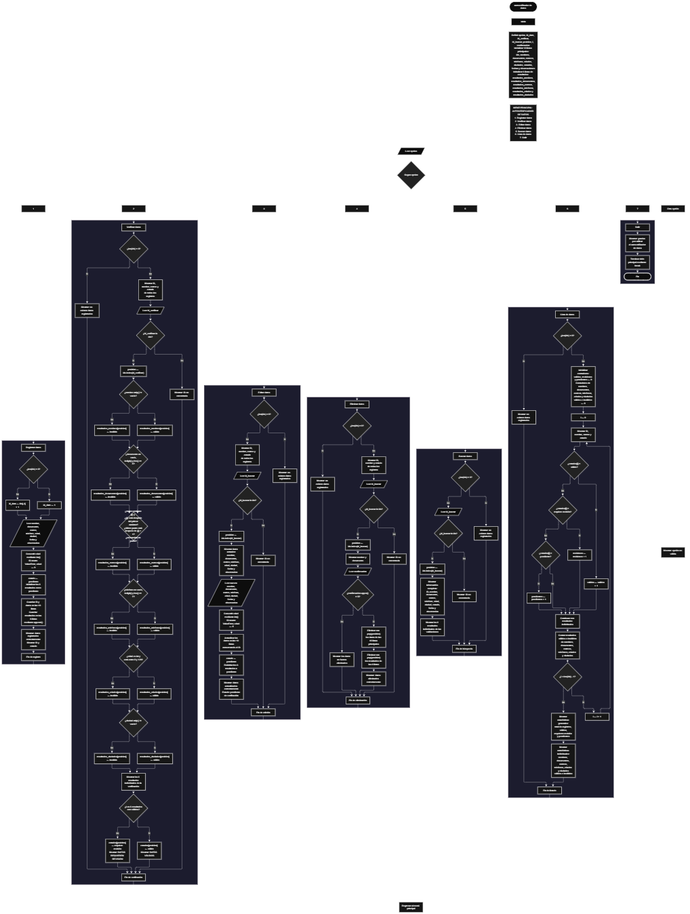

Este proyecto, llamado <b>autoverificador de datos</b>, fue desarrollado en <b>python</b> como un ejercicio práctico para fortalecer la lógica de programación mediante la creación de un sistema de gestión y verificación de información personal desde la consola. El programa cuenta con un menú principal de siete opciones que permite <b>registrar, verificar, editar, eliminar y buscar datos</b>, además de consultar los registros y sus estadísticas. Cada registro almacena información como el nombre, documento, correo electrónico, teléfono, edad, ciudad, fecha y observaciones. Para organizar esta información se utilizan listas relacionadas mediante posiciones, junto con otras seis listas destinadas a almacenar los resultados individuales de las verificaciones. Durante su desarrollo se aplicaron conceptos fundamentales de programación, como variables, listas, estructuras condicionales, ciclos repetitivos, manejo de excepciones, métodos de cadenas y operaciones para administrar registros. Este proyecto permite poner en práctica los conocimientos adquiridos en python y comprender cómo realizar verificaciones básicas de información mediante condiciones y comparaciones.

<h2 align="center">⚙️ Funcionamiento del menú principal</h2>

### ➕ Registrar datos

La opción <b>1) registrar datos</b> permite almacenar un nuevo registro de información personal. Antes de realizar el registro, el programa genera automáticamente un identificador utilizando la condición <b>len(ids) == 0</b>. Si no existen registros, asigna el ID inicial <b>1</b>; de lo contrario, obtiene el último identificador almacenado mediante <b>ids[-1] + 1</b>. Después, solicita el <b>nombre, documento, correo, teléfono, edad, ciudad, fecha y observación</b>. Para almacenar la edad, utiliza las instrucciones <b>try</b> y <b>except ValueError</b>, convirtiendo el dato introducido a un número entero mediante <b>int()</b>. Si ocurre un error durante la conversión, asigna el valor <b>0</b>. Una vez capturada la información, establece el estado general como <b>"pendiente"</b> e inicializa los seis resultados individuales de verificación con el mismo valor. Finalmente, almacena toda la información en sus respectivas listas mediante <b>append()</b> y muestra los mensajes <b>"datos registrados correctamente."</b> junto con el identificador y el estado del registro.

### 🔍 Verificar datos

La opción <b>2) verificar datos</b> permite comprobar la información de un registro mediante seis validaciones: <b>nombre, documento, correo, teléfono, edad y ciudad</b>. Primero, el programa comprueba si existen registros mediante la condición <b>len(ids) == 0</b>. Si no hay información almacenada, muestra el mensaje <b>"no existen datos registrados."</b>. En caso contrario, presenta una lista con el identificador, nombre, correo y estado de cada registro. Después, solicita el ID que se desea verificar y comprueba que exista mediante la condición <b>id_verificar in ids</b>. Si lo encuentra, obtiene su posición utilizando <b>ids.index(id_verificar)</b> y comienza las comprobaciones individuales. Para el nombre, utiliza <b>strip()</b> para verificar que no esté vacío; para el documento, comprueba que contenga únicamente números mediante <b>isdigit()</b> y que tenga al menos cinco caracteres; para el correo, comprueba la presencia y ubicación de los caracteres <b>@</b> y <b>.</b>, además de verificar que no termine en punto; para el teléfono, comprueba que contenga únicamente números y tenga al menos siete caracteres; para la edad, utiliza <b>isinstance()</b> y comprueba que esté entre <b>0 y 120</b>; y para la ciudad, verifica que no esté vacía mediante <b>strip()</b>. Cada resultado se almacena como <b>"válido"</b> o <b>"inválido"</b> en su lista correspondiente. Finalmente, el programa comprueba si los seis resultados son válidos. Si todas las condiciones se cumplen, actualiza el estado general a <b>"válido"</b> y muestra <b>"DATOS VÁLIDOS"</b>. Si al menos una validación no se cumple, cambia el estado a <b>"requiere revisión"</b> y muestra <b>"DATOS REQUIEREN REVISIÓN"</b>. Si el identificador no existe, presenta el mensaje <b>"id no encontrada."</b>.

### ✏️ Editar datos

La opción <b>3) editar datos</b> permite modificar la información de un registro existente. Primero, el programa comprueba si existen datos almacenados. Si las listas están vacías, muestra el mensaje <b>"no existen datos registrados."</b>. En caso contrario, presenta una lista con el ID, nombre, correo y estado de cada registro. Después, solicita el identificador que se desea editar y comprueba su existencia mediante <b>id_buscar in ids</b>. Si encuentra el registro, obtiene su posición utilizando <b>ids.index(id_buscar)</b> y muestra la información actual: nombre, documento, correo, teléfono, edad, ciudad, fecha y observación. A continuación, solicita los nuevos valores y actualiza directamente las posiciones correspondientes de las listas. Para la edad, utiliza nuevamente <b>try</b> y <b>except ValueError</b>, asignando <b>0</b> si la conversión a entero produce un error. Una vez modificados los datos, reinicia el estado general y los seis resultados individuales a <b>"pendiente"</b>, ya que la información actualizada necesita verificarse nuevamente. Finalmente, muestra los mensajes <b>"datos actualizados correctamente."</b> y <b>"estado: pendiente de verificación."</b>. Si el ID introducido no existe, presenta el mensaje <b>"id no encontrada."</b>.

### 🗑️ Eliminar datos

La opción <b>4) eliminar datos</b> permite eliminar un registro de las listas principales y sus respectivos resultados de verificación. Primero, el programa comprueba si existen registros almacenados. Si no hay información, muestra el mensaje <b>"no existen datos registrados."</b>. Si existen registros, presenta una lista con el identificador, nombre y estado de cada uno. Después, solicita el ID que se desea eliminar y comprueba que exista mediante <b>id_buscar in ids</b>. Si lo encuentra, obtiene su posición utilizando <b>ids.index(id_buscar)</b> y muestra el nombre y documento correspondientes. A continuación, solicita una confirmación mediante la instrucción <b>confirmacion.upper() == "S"</b>, que permite aceptar la eliminación aunque la letra se introduzca en minúscula. Si el usuario confirma, el programa utiliza <b>pop(posicion)</b> para eliminar la información de las diez listas principales: <b>ids, nombres, documentos, correos, telefonos, edades, ciudades, estados, fechas y observaciones</b>. También elimina los resultados correspondientes de las seis listas de validación: <b>resultados_nombres, resultados_documentos, resultados_correos, resultados_telefonos, resultados_edades y resultados_ciudades</b>. Finalmente, muestra el mensaje <b>"datos eliminados correctamente."</b>. Si el usuario no confirma la operación, presenta el mensaje <b>"los datos no fueron eliminados."</b>. Si el identificador no existe, muestra <b>"id no encontrada."</b>.

### 🔎 Buscar datos

La opción <b>5) buscar datos</b> permite consultar toda la información de un registro mediante su identificador. Primero, el programa comprueba si existen registros almacenados. Si las listas están vacías, muestra el mensaje <b>"no existen datos registrados."</b>. En caso contrario, solicita el ID que se desea consultar y comprueba su existencia mediante <b>id_buscar in ids</b>. Si encuentra el registro, obtiene su posición utilizando <b>ids.index(id_buscar)</b> y muestra la información completa: <b>ID, nombre, documento, correo, teléfono, edad, ciudad, estado, fecha y observación</b>. Además, presenta una sección con los resultados individuales de las seis validaciones: nombre, documento, correo, teléfono, edad y ciudad. De esta manera, el usuario puede consultar tanto la información almacenada como el resultado de las comprobaciones realizadas anteriormente. Si el identificador introducido no corresponde a ningún registro, muestra el mensaje <b>"id no encontrada."</b>.

### 📋 Lista de datos

La opción <b>6) lista de datos</b> permite visualizar los registros almacenados y consultar estadísticas generales sobre el estado de las verificaciones. Primero, el programa comprueba si existen registros. Si no hay información, muestra el mensaje <b>"no existen datos registrados."</b>. En caso contrario, inicializa los contadores que permiten calcular los registros válidos, los que requieren revisión y los que están pendientes. También inicializa contadores individuales para identificar los resultados válidos e inválidos de cada campo: nombres, documentos, correos, teléfonos, edades y ciudades. Después, utiliza un ciclo <b>for</b> para recorrer las listas y mostrar el identificador, nombre, correo y estado general de cada registro. Durante el recorrido, las estructuras condicionales <b>if</b> y <b>elif</b> comprueban los estados y resultados almacenados para incrementar los contadores correspondientes mediante <b>+= 1</b>. Al finalizar, presenta el total de registros utilizando <b>len(ids)</b>, la cantidad de registros válidos, los que requieren revisión y los pendientes. También muestra las estadísticas individuales de cada campo, indicando cuántos resultados son válidos e inválidos. Esta opción facilita conocer el estado general de la información almacenada y los resultados obtenidos en las verificaciones.

### 🚪 Salir del menú principal

La opción <b>7) salir</b> permite finalizar la ejecución del programa. Cuando el usuario selecciona esta opción, el sistema muestra el mensaje <b>"gracias por utilizar el autoverificador de datos."</b> y utiliza la instrucción <b>break</b> para interrumpir el ciclo <b>while True</b> del menú principal. De esta manera, el programa termina su ejecución y deja de solicitar nuevas opciones.

<h2 align="center">🧠 Temas aplicados en el proyecto</h2>

### 📦 Variables

En este proyecto se utilizan variables para almacenar temporalmente la información introducida por el usuario, controlar las opciones del menú, generar identificadores, localizar registros, guardar resultados de las validaciones y calcular estadísticas. Cada variable cumple una función específica dentro de las operaciones de registro, verificación, edición, eliminación, búsqueda y consulta de información.

🔢 **Opcion:** Almacena la opción seleccionada por el usuario en el menú principal.

🆔 **Id_dato:** Almacena el identificador generado para un nuevo registro.

📝 **Nombre, documento, correo, telefono, edad y ciudad:** Almacenan temporalmente los datos personales introducidos durante el registro o la verificación.

📅 **Fecha y observacion:** Almacenan la fecha del registro y la información adicional proporcionada por el usuario.

🔎 **Id_verificar:** Almacena el identificador del registro que se desea verificar.

🔍 **Id_buscar:** Almacena el identificador utilizado para localizar un registro durante las operaciones de edición, eliminación y búsqueda.

📍 **Posicion:** Almacena el índice correspondiente al registro localizado dentro de las listas.

🔄 **I:** Funciona como contador en los ciclos <b>for</b> utilizados para recorrer los registros y calcular las estadísticas.

✅ **Estado:** Almacena el estado general de un registro, que puede ser <b>pendiente, válido o requiere revisión</b>.

📊 **Validos, revisiones y pendientes:** Almacenan las cantidades de registros correspondientes a cada estado general.

📈 **Contadores individuales:** Almacenan las cantidades de resultados válidos e inválidos de los nombres, documentos, correos, teléfonos, edades y ciudades.

### 🗃️ Listas principales

En este proyecto se utilizan diez listas principales para almacenar la información de los registros. Cada lista guarda un tipo de dato específico y todas se relacionan mediante la misma posición. Por ejemplo, la información de un registro ubicado en la posición <b>0</b> se encuentra distribuida entre <b>ids[0], nombres[0], documentos[0], correos[0], telefonos[0], edades[0], ciudades[0], estados[0], fechas[0] y observaciones[0]</b>. Esta organización permite administrar la información de cada registro de manera ordenada durante las diferentes operaciones del programa.

🆔 **Ids:** Almacena los identificadores de los registros.

📝 **Nombres:** Almacena los nombres de las personas registradas.

🪪 **Documentos:** Almacena los números de documento.

📧 **Correos:** Almacena las direcciones de correo electrónico.

📞 **Telefonos:** Almacena los números de teléfono.

🎂 **Edades:** Almacena las edades de las personas.

🌆 **Ciudades:** Almacena las ciudades correspondientes a cada registro.

📊 **Estados:** Almacena el estado general de las verificaciones.

📅 **Fechas:** Almacena las fechas de los registros.

📄 **Observaciones:** Almacena información adicional de cada registro.

### 📋 Listas de resultados

Además de las listas principales, el programa utiliza seis listas destinadas a almacenar los resultados individuales de las verificaciones. Cada una corresponde a un campo específico y mantiene la misma posición que el registro al que pertenece. Cuando se registra información nueva, los resultados se inicializan como <b>"pendiente"</b>. Después de ejecutar la verificación, cada posición se actualiza con <b>"válido"</b> o <b>"inválido"</b>, según las condiciones establecidas. Esta organización permite consultar los resultados de cada campo por separado y determinar el estado general del registro.

📝 **Resultados_nombres:** Almacena los resultados de la verificación de los nombres.

🪪 **Resultados_documentos:** Almacena los resultados de la verificación de los documentos.

📧 **Resultados_correos:** Almacena los resultados de la verificación de los correos electrónicos.

📞 **Resultados_telefonos:** Almacena los resultados de la verificación de los teléfonos.

🎂 **Resultados_edades:** Almacena los resultados de la verificación de las edades.

🌆 **Resultados_ciudades:** Almacena los resultados de la verificación de las ciudades.

### 🔀 Estructuras condicionales

En este proyecto se utilizan las estructuras <b>if</b>, <b>elif</b> y <b>else</b> para controlar las diferentes operaciones del programa y comprobar las condiciones necesarias durante cada proceso. Estas estructuras permiten verificar si existen registros almacenados, comprobar si un identificador se encuentra en las listas, determinar si los datos cumplen las condiciones establecidas, actualizar el estado general según los resultados obtenidos y controlar la confirmación de las eliminaciones. También permiten clasificar los registros y calcular las estadísticas según los estados y resultados individuales de cada campo.

### 🔄 Estructuras repetitivas

En este proyecto se utilizan las estructuras repetitivas <b>while</b> y <b>for</b>. El ciclo <b>while True</b> mantiene activo el menú principal para que el usuario pueda seleccionar diferentes operaciones hasta utilizar la opción de salida. Por otro lado, los ciclos <b>for</b> permiten recorrer las listas para mostrar los registros disponibles y calcular las estadísticas generales e individuales. Mediante estos recorridos, el programa puede consultar la información almacenada y procesar los resultados de las verificaciones de manera ordenada.

### 🧰 Métodos y funciones de Python

Durante el desarrollo del proyecto se utilizan diferentes funciones y métodos integrados de python para administrar las listas, comprobar información y realizar operaciones sobre los datos almacenados. Estas herramientas permiten simplificar instrucciones y facilitar los procesos de búsqueda, validación, modificación y consulta.

➕ **Append():** Agrega nuevos elementos al final de las listas durante el registro de información.

➖ **Pop():** Elimina los elementos de una posición específica durante la eliminación de registros.

🔎 **Index():** Obtiene la posición de un identificador dentro de la lista correspondiente.

📏 **Len():** Permite conocer la cantidad de elementos almacenados y comprobar si existen registros.

🔠 **Upper():** Convierte el texto de confirmación a mayúsculas para comprobar la respuesta del usuario.

✂️ **Strip():** Elimina los espacios al inicio y al final de una cadena para comprobar si el nombre o la ciudad están vacíos.

🔢 **Isdigit():** Comprueba si una cadena contiene únicamente caracteres numéricos, utilizado en la verificación de documentos y teléfonos.

🔍 **Rfind():** Busca la última aparición de un carácter dentro del correo electrónico para comprobar la posición del último punto.

📧 **Endswith():** Comprueba si el correo electrónico termina con un punto.

🔎 **In:** Permite comprobar si un identificador existe dentro de la lista de registros y si determinados caracteres están presentes en una cadena.

🔢 **Isinstance():** Comprueba si el valor almacenado para la edad corresponde al tipo entero.

### ⚠️ Manejo de excepciones

El programa utiliza las estructuras <b>try</b> y <b>except ValueError</b> durante el registro y la edición de las edades. Estas instrucciones permiten controlar los errores que pueden producirse cuando el usuario introduce un valor que no puede convertirse a un número entero mediante <b>int()</b>. Si ocurre esta excepción, el programa asigna el valor <b>0</b> a la edad y continúa con el registro o la actualización de la información. De esta manera, evita que un error de conversión interrumpa la ejecución durante esas operaciones.

### 🔗 Relación entre listas

Las listas principales y las listas de resultados se encuentran relacionadas mediante sus índices. Esto significa que todas las listas utilizan la misma posición para almacenar la información correspondiente a un mismo registro. Por ejemplo, los datos ubicados en la posición <b>0</b> de las listas principales pertenecen a la misma persona, mientras que los resultados ubicados en la posición <b>0</b> de las listas de validación corresponden a las comprobaciones realizadas sobre esa persona. Esta relación permite actualizar, consultar y eliminar toda la información de un registro manteniendo la correspondencia entre sus datos y sus resultados.

### 📊 Contadores y estadísticas

El programa utiliza variables contadoras para calcular la cantidad de registros según su estado general y los resultados individuales de las verificaciones. Durante el recorrido de las listas, las condiciones permiten identificar si un registro es <b>válido, requiere revisión o permanece pendiente</b>. También se contabilizan los resultados válidos e inválidos de cada uno de los seis campos verificados. Los contadores se incrementan mediante el operador <b>+= 1</b> y, al finalizar el recorrido, se muestran las estadísticas correspondientes. Esta funcionalidad permite conocer la cantidad de registros almacenados y el comportamiento de las validaciones realizadas.

### 🔍 Verificación de información

Una de las características principales del proyecto es la comprobación de seis campos mediante condiciones específicas. Cada campo cuenta con una validación independiente que determina si su contenido cumple los requisitos establecidos en el código. Los resultados se almacenan en listas separadas y posteriormente se utilizan para establecer el estado general del registro. Si todos los campos son válidos, el registro se clasifica como <b>válido</b>; si al menos uno presenta un resultado inválido, se clasifica como <b>requiere revisión</b>. Este proceso permite aplicar condiciones y comparaciones para realizar verificaciones básicas de información personal.

<h2 align="center">¿Cómo se implementaron las operaciones crud en el proyecto?</h2>

Las operaciones <b>crud</b> se implementaron mediante las opciones del menú principal, permitiendo administrar los registros y sus resultados de verificación. La operación <b>crear</b> corresponde a <b>registrar datos</b>, donde se introduce la información personal y se almacena en las listas principales, inicializando los resultados como pendientes. La operación <b>leer</b> se realiza mediante las opciones <b>verificar datos, buscar datos y lista de datos</b>, que permiten consultar los registros, comprobar sus campos y visualizar estadísticas. La operación <b>actualizar</b> corresponde a <b>editar datos</b>, donde se modifican los campos de un registro y se reinician sus resultados para realizar una nueva verificación. Finalmente, la operación <b>eliminar</b> se realiza mediante <b>eliminar datos</b>, que utiliza el método <b>pop()</b> para quitar la información del registro y sus seis resultados correspondientes. Estas operaciones utilizan variables, listas, condicionales y ciclos para gestionar la información almacenada temporalmente durante la ejecución del programa.

<h2 align="center">Diagrama de flujo del proyecto</h2>

<h2 align="center">🛡️ Validaciones del programa</h2>

### 📭 No existen datos registrados

Esta validación se utiliza en las opciones de <b>verificar, editar, eliminar, buscar y lista de datos</b>. El programa comprueba si la lista <b>ids</b> está vacía mediante la condición <b>len(ids) == 0</b>. Si no existen registros almacenados, muestra el mensaje <b>"no existen datos registrados."</b> y evita continuar con las operaciones que necesitan información previamente registrada.

### 🔢 Identificador no encontrado

Esta validación se utiliza durante las operaciones de <b>verificar, editar, eliminar y buscar datos</b>. El programa comprueba si el identificador introducido se encuentra dentro de la lista <b>ids</b> mediante la condición <b>id_buscar in ids</b> o <b>id_verificar in ids</b>, según la operación. Si existe, obtiene su posición mediante <b>index()</b> y continúa con el proceso correspondiente. Si no encuentra coincidencias, muestra el mensaje <b>"id no encontrada."</b>.

### 📝 Verificación del nombre

Esta validación comprueba que el nombre introducido no esté vacío. Para realizarla, el programa utiliza el método <b>strip()</b>, que elimina los espacios al inicio y al final de la cadena. Si después de aplicar este método el contenido no está vacío, almacena el resultado <b>"válido"</b>; de lo contrario, registra <b>"inválido"</b> en la lista <b>resultados_nombres</b>.

### 🪪 Verificación del documento

Esta validación comprueba que el documento no esté vacío, que contenga únicamente números y que tenga una longitud mínima de <b>5 caracteres</b>. Para realizar estas comprobaciones, utiliza los métodos <b>strip()</b> e <b>isdigit()</b>, junto con la función <b>len()</b>. Si se cumplen todas las condiciones, almacena el resultado <b>"válido"</b> en la lista <b>resultados_documentos</b>; de lo contrario, registra <b>"inválido"</b>.

### 📧 Verificación del correo

Esta validación comprueba que el correo electrónico contenga los caracteres <b>@</b> y <b>.</b>, que exista contenido antes del símbolo <b>@</b>, que haya contenido entre el símbolo <b>@</b> y el último punto, y que la dirección no termine en punto. Para realizar estas comprobaciones, utiliza los operadores <b>in</b>, las funciones <b>index()</b> y <b>rfind()</b>, además del método <b>endswith()</b>. Si todas las condiciones se cumplen, almacena <b>"válido"</b> en la lista <b>resultados_correos</b>; de lo contrario, registra <b>"inválido"</b>. Esta comprobación corresponde a una validación básica de formato.

### 📞 Verificación del teléfono

Esta validación comprueba que el teléfono no esté vacío, que contenga únicamente números y que tenga una longitud mínima de <b>7 caracteres</b>. Para realizarla, utiliza los métodos <b>strip()</b> e <b>isdigit()</b>, junto con la función <b>len()</b>. Si se cumplen todas las condiciones, almacena <b>"válido"</b> en la lista <b>resultados_telefonos</b>; en caso contrario, registra <b>"inválido"</b>.

### 🎂 Verificación de la edad

Esta validación comprueba que el dato almacenado sea de tipo entero y que se encuentre dentro del rango comprendido entre <b>0 y 120</b>. Para ello, utiliza la función <b>isinstance()</b> junto con las condiciones <b>edades[posicion] &gt;= 0</b> y <b>edades[posicion] &lt;= 120</b>. Si todas las condiciones se cumplen, almacena <b>"válido"</b> en la lista <b>resultados_edades</b>; de lo contrario, registra <b>"inválido"</b>. Cuando la conversión de la edad produce un error durante el registro o la edición, el programa asigna el valor <b>0</b>, que cumple el rango establecido y puede ser considerado válido por esta comprobación.

### 🌆 Verificación de la ciudad

Esta validación comprueba que la ciudad introducida no esté vacía. Para realizarla, utiliza el método <b>strip()</b>, que elimina los espacios al inicio y al final del texto. Si después de aplicar el método existe contenido, almacena <b>"válido"</b> en la lista <b>resultados_ciudades</b>; de lo contrario, registra <b>"inválido"</b>.

### ⚖️ Resultado general de la verificación

Después de realizar las seis comprobaciones individuales, el programa utiliza una estructura condicional para determinar el estado general del registro. Comprueba que los resultados de <b>resultados_nombres, resultados_documentos, resultados_correos, resultados_telefonos, resultados_edades y resultados_ciudades</b> sean iguales a <b>"válido"</b>. Si todos cumplen esta condición, actualiza la lista <b>estados</b> con el valor <b>"válido"</b> y muestra el mensaje <b>"DATOS VÁLIDOS"</b>. Si al menos uno de los resultados es diferente, establece el estado <b>"requiere revisión"</b> y muestra <b>"DATOS REQUIEREN REVISIÓN"</b>. Esta comprobación permite establecer una clasificación general a partir de los resultados individuales.

### 🔄 Reinicio de resultados al editar datos

Cuando se modifica la información de un registro, el programa reinicia el estado general y los seis resultados individuales con el valor <b>"pendiente"</b>. Esta acción evita conservar los resultados de verificaciones anteriores después de modificar los datos. Por lo tanto, es necesario ejecutar nuevamente la opción <b>verificar datos</b> para obtener resultados actualizados.

### 🔢 Conversión de la edad

Durante el registro y la edición, el programa utiliza las instrucciones <b>try</b> y <b>except ValueError</b> para convertir la edad introducida a un número entero mediante <b>int()</b>. Si el usuario introduce un valor que no puede convertirse, el programa asigna <b>0</b> y continúa con la operación. Debido a que la verificación de edad acepta valores entre <b>0 y 120</b>, este valor puede clasificarse como válido durante la comprobación posterior.

### ⚠️ Confirmación de eliminación

Esta validación se utiliza antes de eliminar un registro. El programa solicita una confirmación y comprueba si la respuesta convertida a mayúsculas mediante <b>upper()</b> es igual a <b>"S"</b>. Si se cumple la condición, elimina el registro y sus resultados correspondientes de las listas. Si la respuesta es diferente, conserva la información y muestra el mensaje <b>"los datos no fueron eliminados."</b>.

### ⚠️ Opción no válida

El menú principal incluye una estructura condicional que evalúa las opciones introducidas por el usuario. Si el valor almacenado en <b>opcion</b> no coincide con ninguna de las opciones definidas, el programa ejecuta el bloque <b>else</b> y muestra el mensaje <b>"opción no válida."</b>. Esta comprobación permite informar cuando se introduce una selección que no pertenece al menú principal.

<h2 align="center">🎯 Objetivo del proyecto</h2>

El objetivo principal de este proyecto es fortalecer la <b>lógica de programación</b> mediante el desarrollo de un sistema de gestión y verificación de información personal en <b>python</b>. A través de su construcción se busca aplicar los conocimientos adquiridos sobre variables, listas, estructuras condicionales, ciclos repetitivos, manejo de excepciones y métodos de cadenas, integrándolos para registrar, consultar, modificar, eliminar y comprobar información de manera organizada. Además, el proyecto permite comprender cómo establecer condiciones de validación, almacenar resultados individuales y generar estadísticas a partir de los registros, creando una base para desarrollar sistemas de verificación y gestión de datos más completos utilizando otros lenguajes y tecnologías.

